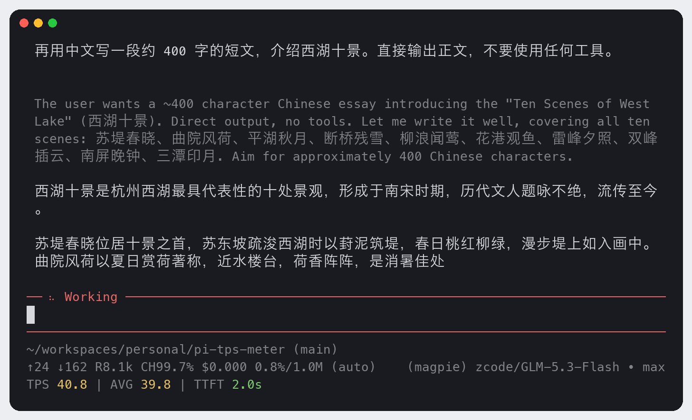
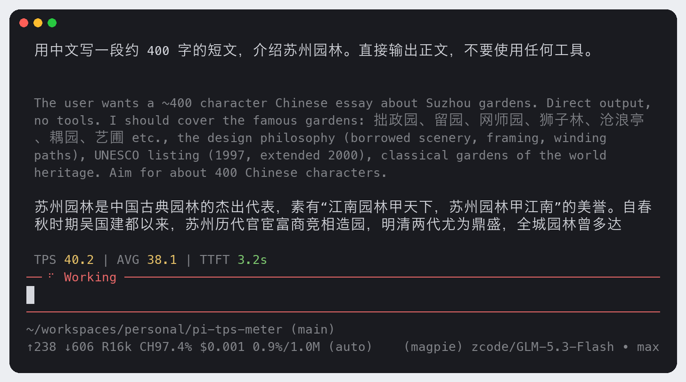

# pi-tps-meter

[](https://www.npmjs.com/package/@jack-yang/pi-tps-meter) [](./LICENSE) [](https://github.com/yangwudong/pi-tps-meter/actions/workflows/ci.yml) 

为 [pi coding agent](https://pi.dev) 实时显示 token 生成速度的扩展：**TPS**（当前速度）、**AVG**（会话均值）、**TTFT**（首 token 延迟），并用模型返回的权威 token 数自动校准，中文内容下读数也可信。

移植自 [opencode-tps-meter](https://github.com/yangwudong/opencode-tps-meter)：测量核心（5 秒滑动窗口、权威 token 校准、AVG 口径）与分档配色和原版一致，只替换了宿主事件层和渲染层。

## 显示效果

```
TPS 42.5 | AVG 38.2 | TTFT 0.8s
```

底部状态条（`/tps status`，默认），流式输出中：



编辑器上方组件（`/tps widget`）：



- **TPS**：流式输出时的实时速度，基于 5 秒滑动窗口，约 10Hz 刷新；超过 1.5 秒没有新 token 时显示 `--`。
- **AVG**：会话级累计平均。所有已完成消息的权威 token 数之和，除以各消息生成时长之和。
- **TTFT**：从本轮请求开始到第一个文本或思考 token 的时间。首个 token 到达立即显示，一直保留到下一次生成开始。

流结束后 AVG / TTFT 摘要不会清空：工具执行期间、等待下一轮响应期间都保持可见，下一条助手消息开始时才更新。

## 颜色

**TPS / AVG**（越高越好）

| 档位 | 范围（tok/s） | 颜色 |
|---|---|---|
| slow | < 20 | 红 |
| normal | 20–50 | 黄 |
| fast | 50–100 | 绿 |
| faster | ≥ 100 | 青 |

**TTFT**（越低越好）

| 档位 | 范围 | 颜色 |
|---|---|---|
| fast | < 10s | 绿 |
| ok | 10–20s | 黄 |
| slow | ≥ 20s | 红 |

档位下界包含在内：恰好 20 TPS 算 normal，恰好 10s 算 ok。阈值可以在配置文件里改。标签和 `--` 用暗色显示。

## 安装

```bash
pi install npm:@jack-yang/pi-tps-meter     # 从 npm 安装（推荐）
pi install /path/to/pi-tps-meter           # 本地目录：不复制，直接从该路径加载
pi -e npm:@jack-yang/pi-tps-meter          # 只在本次启动试用，不写入 settings
```

安装后重启 pi，或在已打开的会话里执行 `/reload`。以后升级用 `pi update --extensions`。npm 版和本地目录版只装一个，两个都装会出现两条读数，命令也会变成 `/tps:1` 和 `/tps:2`。

本地目录请用不带 `npm:` 前缀的路径形式。`pi install npm:./pi-tps-meter` 在 pi 1.5.0 下能装上，但加载不了：pi 按 `npm:` 后面的字符串推算安装目录，路径形式的 spec 永远对不上 `node_modules/@jack-yang/pi-tps-meter`；而且这个相对路径会原样写进 settings，下次启动时 pi 会在新的工作目录下重装并失败。

环境要求：pi ≥ 1.5.0（已在 1.5.0 实测）。没有运行时依赖，也不发起任何网络请求。

## 命令

| 命令 | 作用 |
|---|---|
| `/tps` | 循环切换 status → widget → off |
| `/tps status` | 显示在底部状态条（footer），和其他扩展的状态共用一行 |
| `/tps widget` | 显示为编辑器上方的单行组件 |
| `/tps off` | 完全隐藏。计量仍在后台进行，切回来立即显示当前读数 |

模式写入配置文件，下次启动沿用。

## 配置

配置文件位于 `~/.pi/agent/pi-tps-meter/config.json`；设置了 `PI_CODING_AGENT_DIR` 时，位于该目录下的 `pi-tps-meter/config.json`。

```json
{
  "mode": "status",
  "tiers": {
    "tps":  { "slow": 20, "normal": 50, "fast": 100 },
    "ttft": { "fast": 10000, "ok": 20000 }
  }
}
```

| 键 | 默认值 | 说明 |
|---|---|---|
| `mode` | `"status"` | `status` / `widget` / `off`。`/tps` 只改写这个键，其他内容原样保留 |
| `tiers.tps` | `{ slow: 20, normal: 50, fast: 100 }` | TPS 与 AVG 的分档阈值（tok/s） |
| `tiers.ttft` | `{ fast: 10000, ok: 20000 }` | TTFT 分档阈值（毫秒） |

- 所有键都可省略，按字段覆盖默认值，例如只写 `{ "tiers": { "tps": { "fast": 80 } } }`。不是数字的值会被忽略。
- 文件在会话启动时读取，手动修改后执行 `/reload` 生效。
- 文件无法解析时，使用默认值并给出提示；这种情况下 `/tps` 也不会覆盖它。

## 工作原理

### TPS

每个流式 delta（text、thinking、toolcall 三种都算）按 UTF-8 字节数 ÷ 4 估算 token 数，记入 5 秒滑动窗口：

```
TPS = 窗口内估算 token 之和 × 校准因子 ÷ (当前时间 − 窗口内最早样本)
```

时长下限是 1 秒，避免刚开始的一两个 chunk 显示成尖峰；最后一个样本已经超过 1.5 秒时不显示。跨度用墙钟时间计算，不累加 delta 之间的间隔，因为网络会把多个 token 打包到达，间隔之和会让速率虚高。

### 校准

字节 ÷ 4 对中文偏差很大（一个汉字占 3 字节）。每条消息结束时，用 pi 给出的权威输出 token 数（`usage.output`）除以这条消息的累计估算值，得到一个比率（限制在 0.3–3.0 之间）。扩展保留最近 10 个比率，取**中位数**作为校准因子，用于之后消息的实时速率；第一条消息结束之前，因子是 1.0。

实测（GLM-5.3-Flash，400–500 字中文短文）：未校准时实时 TPS 偏高 17%–30%；校准一轮之后，按校准因子换算的整条消息 token 数与权威值相差 +1%～+12%。

### AVG

```
AVG = Σ 权威 token 数 ÷ Σ (最后一个 delta − 第一个 delta)
```

只统计已完成的消息，单条消息的时长下限为 1 秒，所以 TTFT 等待和工具执行时间都不计入。出错或被中断的消息（`usage` 不完整）不计入 AVG，也不参与校准。

### TTFT

TTFT 从 `turn_start` 开始计时（在 pi 里，一个 turn 就是一次模型请求），到这条消息的第一个 text 或 thinking delta 为止。toolcall delta 不会结束 TTFT 等待，但会计入 TPS。只调用工具、没有任何文本或思考输出的消息，TTFT 显示 `--`。

为什么不从 `message_start` 开始算：pi 收到 HTTP 响应头之后才发出 `message_start`，而多数服务端要排完队、做完 prefill 才返回响应头。实测中，响应头在请求发出约 2 秒后才到，`message_start` 和第一个 delta 落在同一毫秒；从 `message_start` 算，TTFT 几乎永远是 0。

### 工具调用

工具在两条助手消息之间执行。每条消息结束时清空滑动窗口，所以工具耗时不会摊进下一条消息的速率。

## 与 opencode-tps-meter 的差异

- TTFT 起点用 `turn_start`，对应原版的 `session.step.started`（模型调用开始）。
- 下一条助手消息开始时清空 TTFT，原版要等到下一个首 token 才覆盖。
- toolcall delta 计入 TPS 和校准，因为 pi 的 `usage.output` 包含工具调用参数的 token；原版只统计文本和推理。TTFT 仍然只认文本和思考。
- 权威 token 数直接用 `usage.output`：pi 的 output 已经包含推理 token，原版需要把 output 和 reasoning 相加。
- 没有移植思考粒子动画，pi 自带工作指示器。
- 颜色用 ANSI 基本色：红 31、黄 33、绿 32、青 36，标签用暗色；原版用的是 opencode 主题槽位。

## 已知限制

- **不流式输出的推理**：有些模型按推理 token 计费，但不把推理内容流式发出来。这时校准比率会顶到 3.0 上限，AVG 也会偏高（原版同样如此）。
- **一次性返回工具参数的 provider**（如 Gemini）：消息末尾会出现一个短暂的 TPS 尖峰，消息结束后立即清除。
- **底部状态条依赖 pi 的默认 footer**：如果另一个扩展换掉了 footer，并且不渲染扩展状态（比如 awesome-pi-themes 的 look-pack），请改用 `/tps widget`。
- **AVG 和校准只在当前会话内累计**：`/new`、`/resume`、`/fork`、`/reload` 会重新开始；不会从历史记录里重建。
- **TTFT 包含客户端准备时间**：包括请求前的上下文处理（实测约 7ms）和 provider 层的自动重试等待，也就是用户实际等待的时间。
- **时间戳取自 pi 把事件派发给扩展的时刻**：其他扩展的慢 handler 会推迟派发，从而影响读数。

## 开发

```bash
npm test                            # node --test，不需要安装依赖（Node ≥ 22.19）
npm install && npm run typecheck    # 可选：tsc 严格检查，会装上 pi 作为 peer 依赖以获得类型
pi -e .                             # 在真实会话中试用
```

## 许可证

MIT
